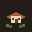
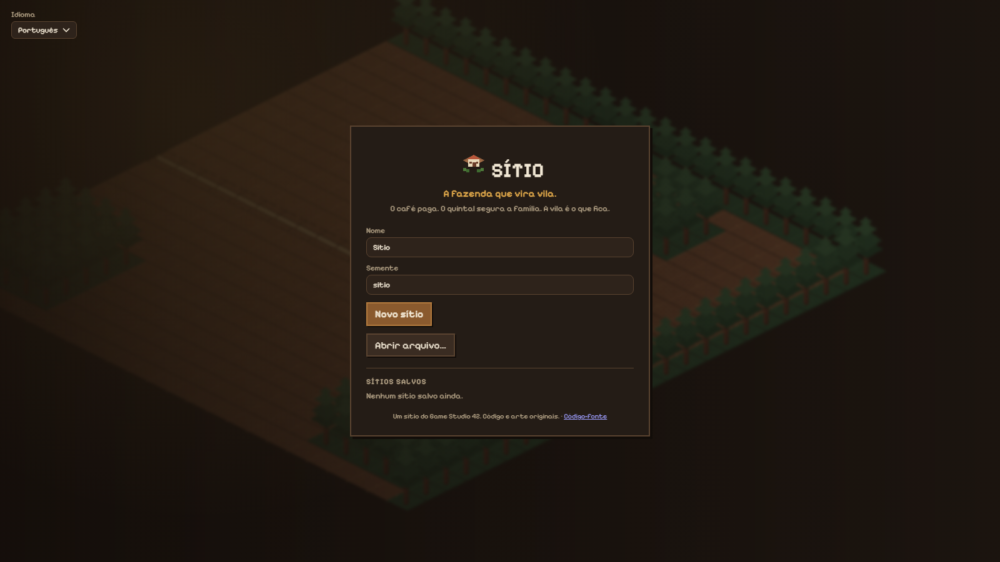
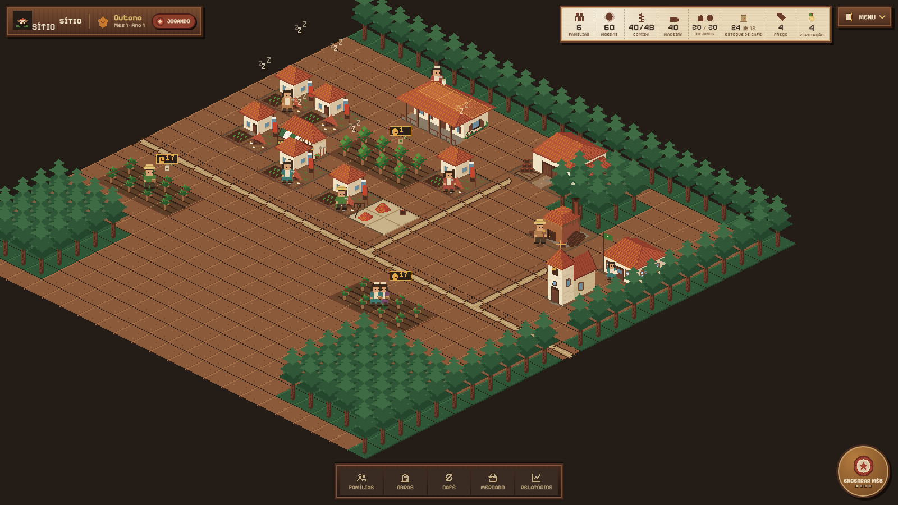
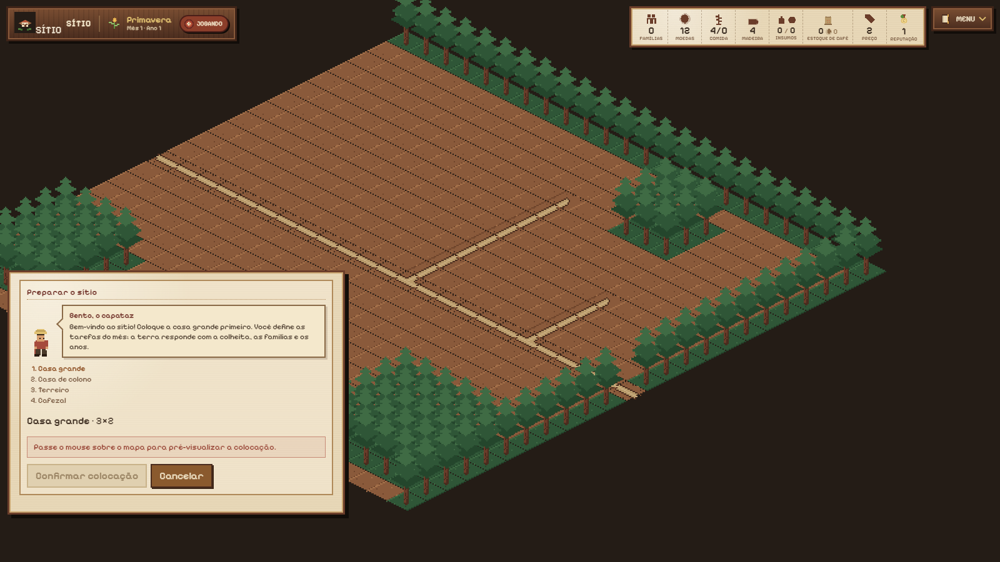
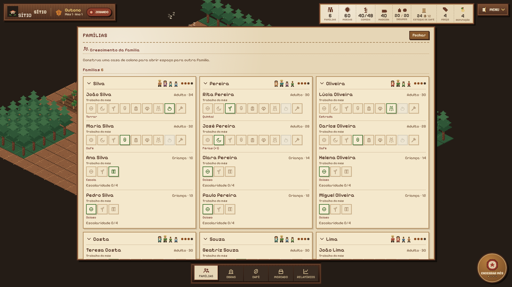
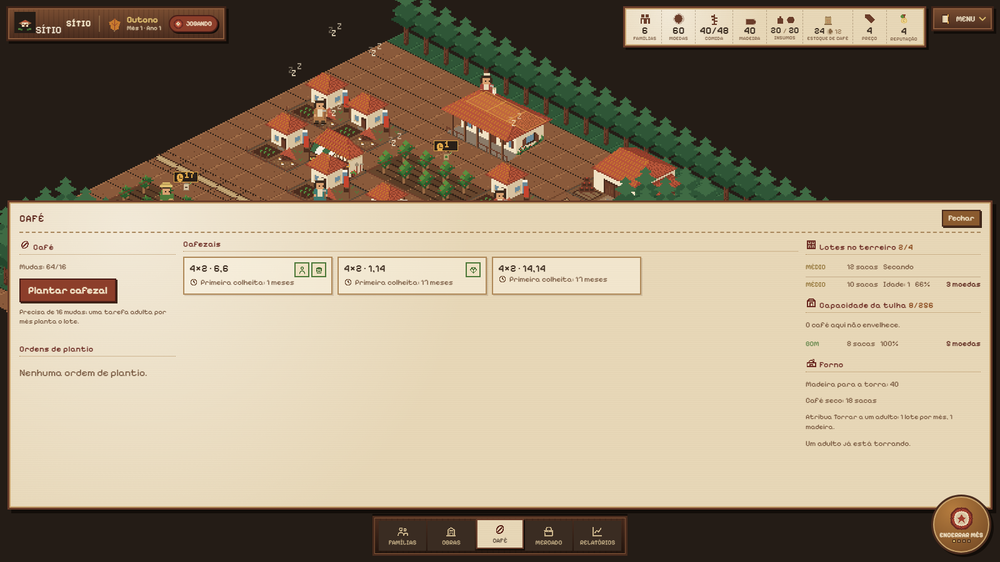
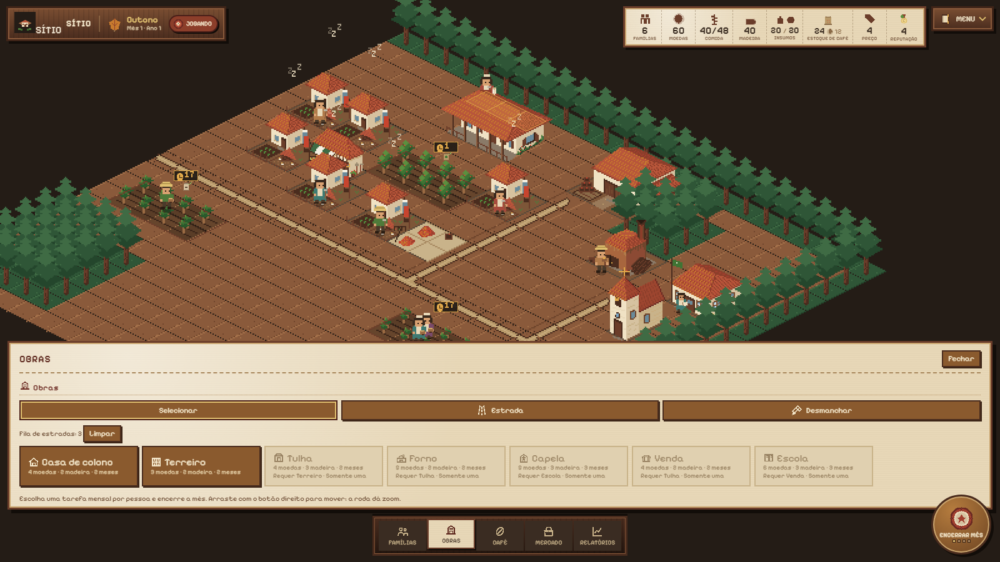
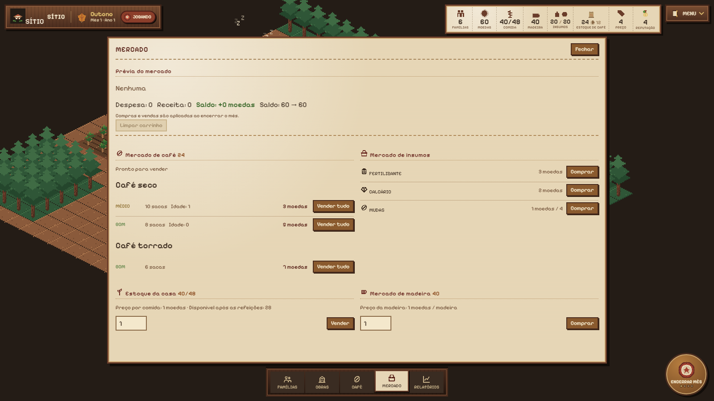

<p align="center">
  
</p>

<h1 align="center">Sítio</h1>

<p align="center"><strong>The farm that becomes a village.</strong></p>

<p align="center">
  <a href="https://gamestudio42.github.io/sitio/"></a>
  <a href="https://github.com/gamestudio42/sitio/actions/workflows/deploy.yml"></a>
  <a href="https://github.com/gamestudio42/sitio/stargazers"></a>
  <a href="https://github.com/gamestudio42/sitio/fork"></a>
  <a href="https://github.com/gamestudio42"></a>
  <a href="LICENSE"></a>
</p>

<p align="center">
  A coffee farm that becomes a village, running in the browser.
  Place the casa grande, one colono house, one terreiro and the first coffee lot;
  then fill the monthly almanac with work, coffee and family decisions.
  No install. Interface in English, Portuguese, Spanish, French and German.
</p>

<p align="center">
  <a href="https://gamestudio42.github.io/sitio/">
    
  </a>
</p>

<p align="center">
  <a href="https://gamestudio42.github.io/sitio/">
    
  </a>
</p>

## Manual

The full game manual is bilingual:

- **[English manual](docs/manual.md)**
- **[Manual em português](docs/manual.pt-BR.md)**

It covers the monthly loop, families, the complete coffee chain, inputs,
buildings, demolition, the market, reports, saves, the HUD and a reference table
of every important constant.

## See the farm

<table>
<tr>
<td align="center" width="50%" valign="top">
<br>
The almanac HUD keeps the map visible while the book holds the month.
</td>
<td align="center" width="50%" valign="top">
<br>
Bento explains the first placements and the coffee chain.
</td>
</tr>
<tr>
<td align="center" width="50%" valign="top">
<br>
Every person has one task, chosen from colored icons.
</td>
<td align="center" width="50%" valign="top">
<br>
Cafezais show who is working and which inputs were applied.
</td>
</tr>
<tr>
<td align="center" width="50%" valign="top">
<br>
A horizontal construction tray shows costs and requirements.
</td>
<td align="center" width="50%" valign="top">
<br>
Coffee is sold by batch, preserving age and exact price.
</td>
</tr>
</table>

## Why Sítio

- **Play in the browser.** Open the link and start a farm. Nothing to download.
- **Start from the landscape.** Place the casa grande, one colono house, one
  terreiro and a free coffee lot. Every other building is paid and constructed
  later.
- **One monthly task per person.** Adults work the yard, coffee, roads,
  construction, clearing, fertilizer, limestone or roasting. Children work the
  yard at half output or go to school.
- **A complete coffee chain.** Coffee is harvested into batches, dries for a
  month, ages on the terreiro without a tulha, stays stable in the tulha and can
  be roasted in a forno for a higher price.
- **A market by batch.** Dry and roasted batches are sold separately, so every
  sack keeps its age and price.
- **A farm book, not a spreadsheet.** Families, Works, Coffee, Market and
  Reports open as almanac pages; purchases and sales queue until month end.
- **A forecast you can plan around.** Each lot shows when the current coffee crew
  will reach the first and the complete harvest.
- **Build, tear down and reuse.** Footprints never overlap, and a demolished
  building returns half of its wood.
- **Original pixel art.** Terrain, roads, coffee, buildings, people and HUD
  icons come from the Aseprite source in [`art/sitio`](art/sitio).
- **Your farm stays with you.** Autosave in the browser, plus export and import
  of `.sitio.json` files.
- **Five languages.** English, Portuguese, Spanish, French and German.

## Play

Open **[gamestudio42.github.io/sitio](https://gamestudio42.github.io/sitio/)**.
Choose a farm name and seed, then place the four starters on the map. The first
visit follows your browser language.

| | |
| --- | --- |
| **Live game** | [gamestudio42.github.io/sitio](https://gamestudio42.github.io/sitio/) |
| **Languages** | English, Portuguese, Spanish, French, German |
| **Saves** | Autosave in the browser, plus `.sitio.json` export and import |
| **Clock** | Monthly: four seasons of four months, three years (48 months) |
| **End of the farm** | Six families, a chapel, a school, a shop and morale of at least 2 |

| Action | How |
| --- | --- |
| Place a starter | Pick the blueprint, click the map, then confirm |
| Assign monthly work | Families page, one icon per person |
| Plan a road | Works page, Road tool; an adult builds one queued tile per month |
| Clear forest | Choose the axe icon, click a forest tile |
| Demolish | Works page, Demolish tool, click the building |
| End the month | The wax stamp in the bottom-right corner |

## Develop

Requires Node.js 22+ and pnpm 10.

```sh
pnpm install
pnpm dev        # http://localhost:5178
```

Docker is also available with `docker compose up`.

| Command | Purpose |
| --- | --- |
| `pnpm check` | Lint, type check, unit tests and the production build |
| `pnpm test:e2e` | Playwright smoke test (builds and serves the app) |
| `pnpm art` | Export `art/sitio/sitio.aseprite` to the app atlas |
| `pnpm art:draw` | Regenerate the `.aseprite` from `tools/art-sitio.lua` |

In development, the main menu exposes a **Test farm** button with every building,
six families and coffee at every processing stage. It is not included in
production builds.

Every push to `main` builds `apps/web/dist` for GitHub Pages. A different
deployment path can be set with `BASE_PATH=/your-path/ pnpm build`.

The simulation is deterministic and runs in a Web Worker. React sends commands
and reads the farm; the renderer draws it with the Sítio theme. See the
[architecture](docs/architecture.md), [game manual](docs/manual.md),
[art notes](art/sitio/README.md), [agents](AGENTS.md) and
[contribution guide](CONTRIBUTING.md).

### Art source

`art/sitio/sitio.aseprite` is the source of truth. Use `pnpm art` after manual
Aseprite edits; `pnpm art:draw` rebuilds the document from the Lua generator and
discards manual edits.

The current manual art pass is documented in
[`art/sitio/visual-pass.md`](art/sitio/visual-pass.md), with before/after
comparisons for the refreshed buildings and trees.

## Fork & remix

Sítio is AGPL-3.0-or-later for the game code and Apache-2.0 for the reusable
libraries. Fork it, change the rules, ship your own farm on GitHub Pages.

```sh
git clone https://github.com/gamestudio42/sitio.git
cd sitio
pnpm install
pnpm dev
```

Enable Pages on your fork (the workflow in `.github/workflows/deploy.yml`
already publishes `apps/web/dist`). Or host the build anywhere:

```sh
BASE_PATH=/your-path/ pnpm build
```

Ideas and patches: [good first issues](https://github.com/gamestudio42/sitio/labels/good%20first%20issue).

## Licence

Sítio uses a mixed license:

| Path | License |
| --- | --- |
| `apps/web/`, `packages/simulation/`, `tests/`, root build and config files | `AGPL-3.0-or-later` |
| `packages/kernel/`, `packages/bridge/`, `packages/view-iso/`, `packages/chrome/` | `Apache-2.0` |
| `tools/` | `Apache-2.0` |
| `README.md`, `AGENTS.md`, `CONTRIBUTING.md`, `THIRD-PARTY.md`, `LICENSING.md`, `art/`, `apps/web/public/art/`, `apps/web/public/favicon.svg`, `docs/` | `CC-BY-4.0` |
| `apps/web/public/fonts/` | `OFL-1.1` |

Root build and config files include `package.json`, `pnpm-lock.yaml`,
`pnpm-workspace.yaml`, `tsconfig*.json`, `eslint.config.js`, `vitest.config.ts`,
`playwright.config.ts`, `docker-compose.yml` and `.github/`.

The game code is free software under the GNU Affero General Public License,
version 3 or later. The corresponding source is
[github.com/gamestudio42/sitio](https://github.com/gamestudio42/sitio). Art,
screenshots and documentation are © 2026 Game Studio 42 and licensed under
CC-BY-4.0. The bundled Pixelify Sans font remains under the SIL Open Font
License 1.1.

Code, pixel art and synthesized sound are original. Micropolis (GPLv3) and
OpenSC2K were studied as behavioural references only; no code or assets were
copied. See [LICENSING.md](LICENSING.md), [THIRD-PARTY.md](THIRD-PARTY.md) and
[AGENTS.md](AGENTS.md).
