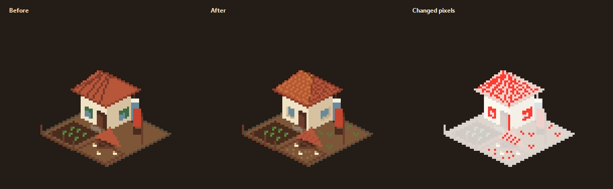
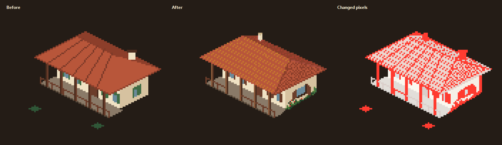
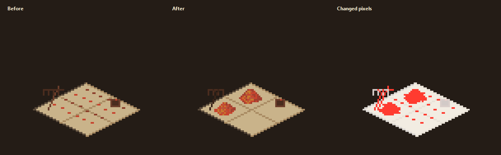
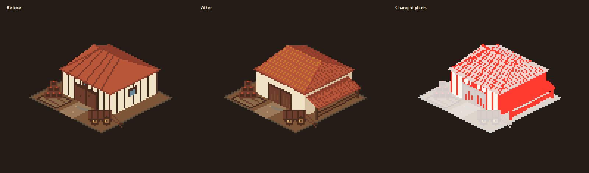
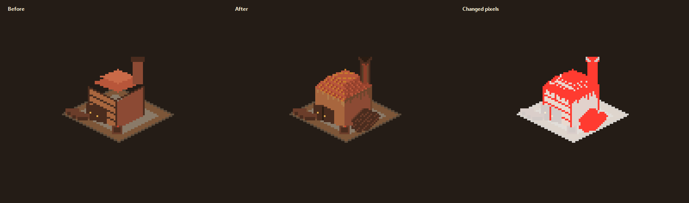
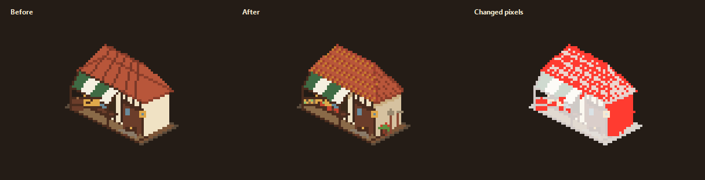
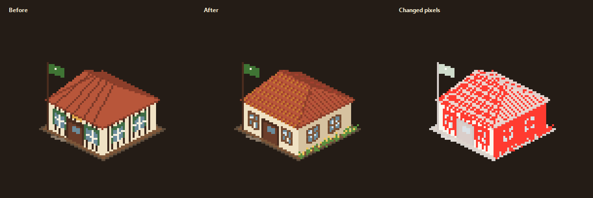
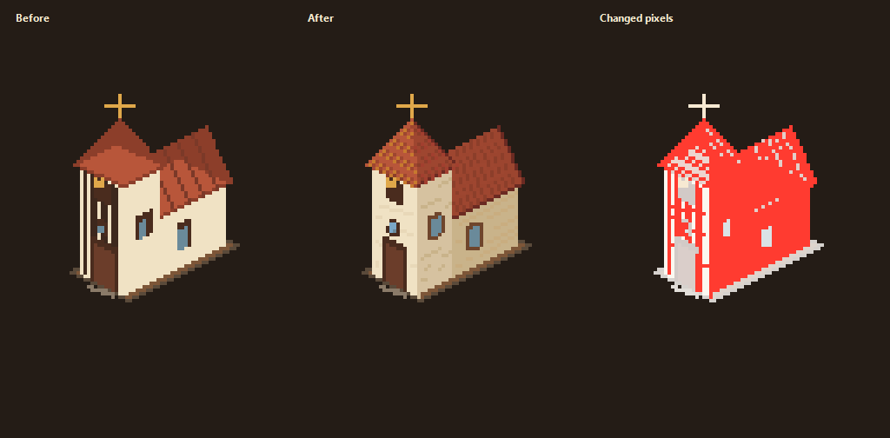
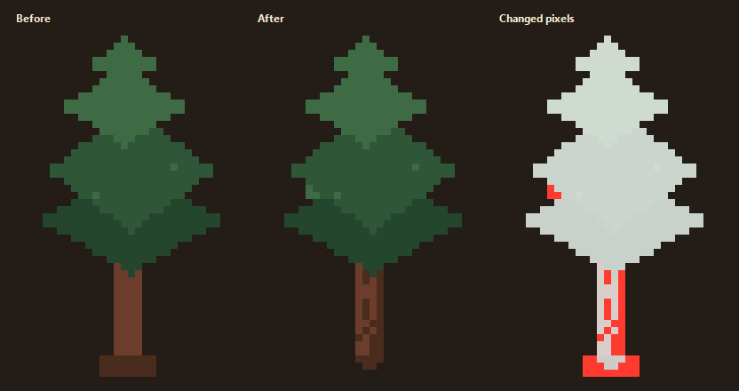

# Sítio visual pass

Working notes for the manual pixel-art pass on `art/sitio/sitio.aseprite`.
Each edited asset keeps a before/after comparison so changes can be reviewed
without opening Aseprite.

**Branch:** `art/sitio-visual-pass`
**Source of truth:** `art/sitio/sitio.aseprite`
**Export command:** `pnpm art` — never `pnpm art:draw` after manual edits.

## Progress

| Group | Status |
| --- | --- |
| Buildings | Edited; comparisons ready |
| People and family portrait | Pending |
| Coffee and trees | Tree edited; coffee pending |
| Terrain, roads and field icons | Pending |
| HUD | Pending |

## Buildings

### Colono house

| | |
| --- | --- |
| Slice | `house`, `(0,160,96,80)` |
| Base | `(48,56)` |
| Pixels changed | 216 |
| Changed bounds | `(33,25)` to `(73,68)` |
| Before | [house-before.png](visual-pass/house-before.png) |
| After | [house-after.png](visual-pass/house-after.png) |
| Diff | [house-diff.png](visual-pass/house-diff.png) |

### Casa grande

| | |
| --- | --- |
| Slice | `sede`, `(160,16,112,88)` |
| Base | `(64,52)` |
| Pixels changed | 1244 |
| Changed bounds | `(16,12)` to `(108,80)` |
| Latest adjustment | 669 pixels, `(20,15)` to `(82,55)` |
| Before | [sede-before.png](visual-pass/sede-before.png) |
| After | [sede-after.png](visual-pass/sede-after.png) |
| Diff | [sede-diff.png](visual-pass/sede-diff.png) |
| Latest pass | [sede-adjustment-comparison.png](visual-pass/sede-adjustment-comparison.png) |

### Terreiro

| | |
| --- | --- |
| Slice | `terreiro`, `(112,160,96,80)` |
| Pixels changed | 219 |
| Changed bounds | `(23,42)` to `(71,64)` |
| Before | [terreiro-before.png](visual-pass/terreiro-before.png) |
| After | [terreiro-after.png](visual-pass/terreiro-after.png) |
| Diff | [terreiro-diff.png](visual-pass/terreiro-diff.png) |

### Tulha

| | |
| --- | --- |
| Slice | `tulha`, `(0,368,128,104)` |
| Pixels changed | 1146 |
| Changed bounds | `(38,20)` to `(108,71)` |
| Before | [tulha-before.png](visual-pass/tulha-before.png) |
| After | [tulha-after.png](visual-pass/tulha-after.png) |
| Diff | [tulha-diff.png](visual-pass/tulha-diff.png) |

### Forno

| | |
| --- | --- |
| Slice | `forno`, `(256,480,128,104)` |
| Pixels changed | 658 |
| Changed bounds | `(47,23)` to `(84,66)` |
| Before | [forno-before.png](visual-pass/forno-before.png) |
| After | [forno-after.png](visual-pass/forno-after.png) |
| Diff | [forno-diff.png](visual-pass/forno-diff.png) |

### Venda

| | |
| --- | --- |
| Slice | `venda`, `(128,368,96,64)` |
| Pixels changed | 516 |
| Changed bounds | `(27,9)` to `(70,48)` |
| Before | [venda-before.png](visual-pass/venda-before.png) |
| After | [venda-after.png](visual-pass/venda-after.png) |
| Diff | [venda-diff.png](visual-pass/venda-diff.png) |

### Escola

| | |
| --- | --- |
| Slice | `escola`, `(224,368,96,88)` |
| Pixels changed | 978 |
| Changed bounds | `(21,26)` to `(79,71)` |
| Before | [escola-before.png](visual-pass/escola-before.png) |
| After | [escola-after.png](visual-pass/escola-after.png) |
| Diff | [escola-diff.png](visual-pass/escola-diff.png) |

### Capela

| | |
| --- | --- |
| Slice | `capela`, `(320,368,80,112)` |
| Pixels changed | 1293 |
| Changed bounds | `(17,24)` to `(62,75)` |
| Before | [capela-before.png](visual-pass/capela-before.png) |
| After | [capela-after.png](visual-pass/capela-after.png) |
| Diff | [capela-diff.png](visual-pass/capela-diff.png) |

## Trees

### Tree

| | |
| --- | --- |
| Slice | `tree`, `(128,16,32,48)` |
| Pixels changed | 44 |
| Changed bounds | `(7,21)` to `(19,47)` |
| Before | [tree-before.png](visual-pass/tree-before.png) |
| After | [tree-after.png](visual-pass/tree-after.png) |
| Diff | [tree-diff.png](visual-pass/tree-diff.png) |

## Change log

| Asset | Status | Notes |
| --- | --- | --- |
| Colono house | Edited; comparison ready | 216 pixels changed; roof, walls and yard details |
| Casa grande | Edited; comparison ready | 1244 pixels changed; latest pass adjusted 669 pixels |
| Terreiro | Edited; comparison ready | 219 pixels changed |
| Tulha | Edited; comparison ready | 1146 pixels changed |
| Forno | Edited; comparison ready | 658 pixels changed |
| Venda | Edited; comparison ready | 516 pixels changed |
| Escola | Edited; comparison ready | 978 pixels changed |
| Capela | Edited; comparison ready | 1293 pixels changed |
| Tree | Edited; comparison ready | 44 pixels changed |

All comparisons are shown at 4×. The tree uses 8× because its source slice is
32×48.

## Review checklist

- [ ] Slices and dimensions unchanged, or renderer anchors updated
- [ ] `pnpm art`
- [ ] `pnpm test`
- [ ] `/?art`
- [ ] In-game screenshots
- [ ] Final `pnpm check`
- [ ] Final `pnpm test:e2e`
