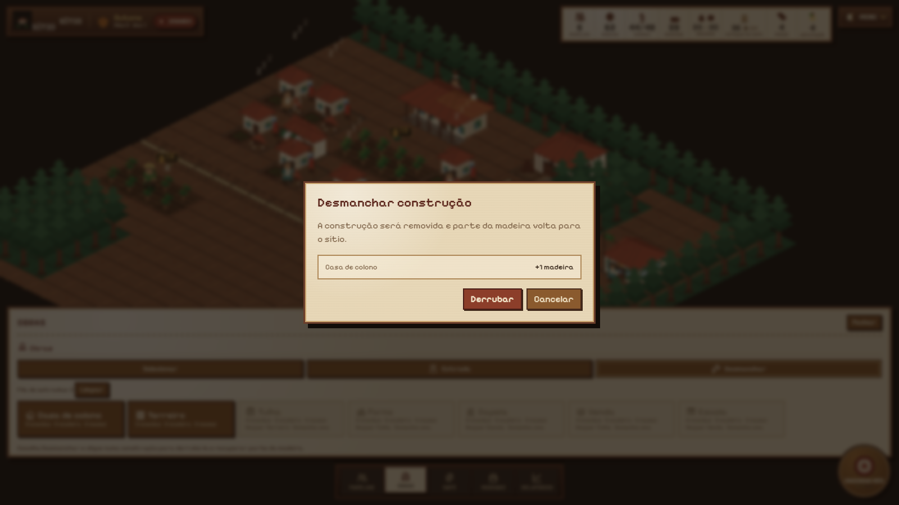
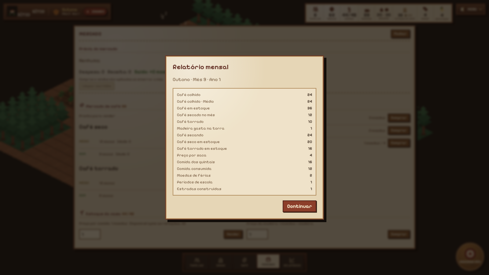
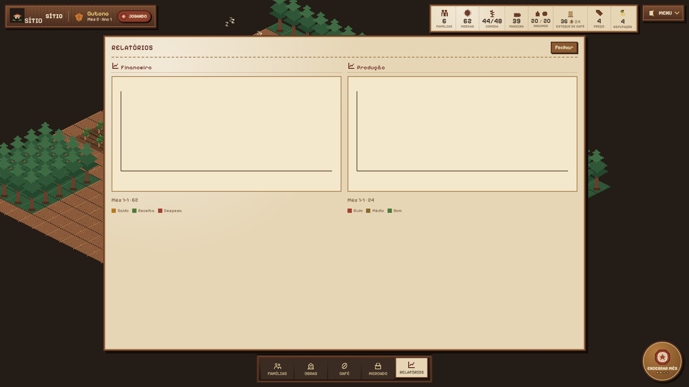

# Sítio — Manual do Jogo

**A fazenda que vira vila.**

**Português** · [English](manual.md)

Sítio é um jogo de fazenda em meses. Você posiciona as primeiras construções,
escolhe uma tarefa por pessoa e encerra o mês. A simulação decide a colheita, o
café que seca, as famílias que ficam ou partem e a vila que pode nascer.

Não há pressão em tempo real. Todas as decisões são tomadas antes do fim do mês,
e todo resultado aparece no relatório mensal.

---

## Índice

1. [A premissa](#1-a-premissa)
2. [Começando um sítio](#2-começando-um-sítio)
3. [O mês](#3-o-mês)
4. [Terra, estradas e construções](#4-terra-estradas-e-construções)
5. [Pessoas e famílias](#5-pessoas-e-famílias)
6. [O café do plantio à venda](#6-o-café-do-plantio-à-venda)
7. [Fertilizante e calcário](#7-fertilizante-e-calcário)
8. [Obras e demolição](#8-obras-e-demolição)
9. [O mercado](#9-o-mercado)
10. [Relatórios, vitória e derrota](#10-relatórios-vitória-e-derrota)
11. [Saves e fazenda teste](#11-saves-e-fazenda-teste)
12. [HUD e controles](#12-hud-e-controles)
13. [Tabelas de referência](#13-tabelas-de-referência)
14. [Perguntas frequentes](#14-perguntas-frequentes)

---

## 1. A premissa

Uma fazenda de café vira uma vila. O jogador não controla a colheita
diretamente; decide quem trabalha, o que é construído, o que é vendido e quando
o mês termina.

O sítio começa com quatro colocações iniciais gratuitas:

- a **casa grande**;
- uma **casa de colono**;
- um **terreiro**;
- um **cafezal**.

Todo o resto custa moedas e madeira e é construído nos meses seguintes.

O calendário tem **48 meses**: quatro estações de quatro meses, ao longo de três
anos.

---

## 2. Começando um sítio

Escolha o nome e a semente do sítio e posicione as quatro construções iniciais
em terra aberta.

1. Passe o mouse sobre o mapa para pré-visualizar o footprint.
2. Clique numa área aberta para fixar o blueprint.
3. Confirme a colocação.
4. Repita para a casa, o terreiro e o cafezal.

O capataz Bento explica cada etapa. O calendário só começa depois da última
confirmação.

### Regras de colocação

- As construções iniciais não podem se sobrepor a outro prédio, canteiro, café,
  estrada planejada ou ordem de plantio.
- A mesma regra vale para todas as construções posteriores.
- Estradas, mata, prédios, café e canteiros bloqueiam a colocação.
- O footprint de cada construção é fixo e não gira.

### Controles

| Ação | Como |
| --- | --- |
| Mover o mapa | Arrastar com o botão direito ou do meio |
| Zoom | Roda do mouse |
| Escolher ferramenta | Página Obras |
| Colocar construção | Escolher o prédio, clicar no mapa e confirmar |
| Atribuir trabalho | Página Famílias, um ícone de tarefa por pessoa |
| Limpar mata | Escolher o ícone de machado e clicar numa célula de mata |
| Encerrar o mês | Carimbo de cera no canto inferior direito |

---

## 3. O mês

Cada pessoa tem **uma tarefa mensal**. A tarefa continua até ser trocada.

O mês é resolvido nesta ordem:

1. Vendas de comida e pedidos do mercado, incluindo café e madeira.
2. Tarefas mensais, incluindo a torra.
3. Café seco no terreiro vai para a tulha enquanto couber.
4. Café seco que ficou no terreiro envelhece e pode estragar.
5. O café em secagem avança; o café recém-seco tenta ir para a tulha.
6. A colheita de outono cria novos lotes de café.
7. As famílias comem.
8. Relatório, histórico e totais são atualizados.
9. O mês avança.

O relatório mensal mostra o que realmente aconteceu. Use-o para ajustar o mês
seguinte.

---

## 4. Terra, estradas e construções

O mapa tem **24 × 24** células. O terreno é terra aberta, mata ou estrada.

### Mata e limpeza

- **Limpeza** é uma tarefa adulta direcionada: escolha o ícone de machado, o
  painel da família fecha e você clica numa célula de mata.
- Um adulto limpa uma célula de mata por mês.
- A limpeza rende **2 madeiras** e transforma a célula em terra aberta.
- Limpar não custa moedas.

### Estradas

- Planeje estradas com a ferramenta Estrada.
- Um adulto atribuído a Estrada constrói uma célula enfileirada por mês.
- Estradas não custam moedas nem madeira.
- Estradas não são pré-requisito para construir; apenas ocupam terreno.

### Construção

As construções são feitas pela página Obras:

1. Escolha um prédio.
2. Posicione o canteiro em terra aberta.
3. Atribua um ou mais adultos ao canteiro.
4. A obra termina quando o progresso atinge os meses necessários.

Um canteiro precisa de unidades de trabalho. Um adulto entrega trabalho a cada
mês; adultos educados entregam mais. Quando o canteiro termina, os trabalhadores
voltam de férias.

Footprints não podem se sobrepor a prédios, canteiros, café, estradas planejadas
ou ordens de plantio. A prévia fica vermelha quando o footprint está bloqueado.

---

## 5. Pessoas e famílias

Uma casa de colono traz uma família: **dois adultos e duas crianças**.

### Adultos

Adultos podem exercer todas as tarefas mensais:

- ocioso;
- férias / descanso;
- quintal;
- café;
- estrada;
- torrar;
- fertilizar;
- calcar;
- limpar mata;
- trabalhar numa obra;
- plantar um cafezal.

Um adulto de férias rende **1 moeda** para a família.

### Crianças

Crianças podem:

- ficar ociosas;
- trabalhar no quintal com metade do rendimento adulto;
- estudar, se houver escola e a criança tiver pelo menos 6 anos.

Dois meses de estudo educam a criança. A educação é permanente. Adultos educados
contam como o dobro de unidades de trabalho no café e na construção e produzem
comida extra no quintal.

### Comida e moral

- Cada família come **2 comidas** por mês.
- A despensa da casa guarda até **8 comidas por família**.
- Comida acima do limite é desperdiçada.
- Fome reduz a moral.
- Famílias partem com moral 0.
- O sítio é perdido quando não resta nenhuma família.

Uma família pode ser convidada para uma casa de colono vazia por **4 moedas**.
Novas famílias também podem chegar no fim da estação quando a reputação é pelo
menos 3 e há casa vazia.

---

## 6. O café do plantio à venda

### 6.1 Plantio

Um novo cafezal é uma ordem **4 × 2**:

- precisa de **16 mudas**;
- termina com **2 unidades de trabalho**;
- um adulto sem educação entrega essas unidades em um mês;
- mais adultos não fazem a ordem terminar antes de um mês.

O cafezal inicial já começa estabelecido, no estágio *em formação*. Um cafezal
criado depois começa como *muda*.

### 6.2 Crescimento e colheita

Cada cafezal tem **8 células** e **16 pés** (dois pés por célula).

As células avançam um estágio por mês de trabalho no café:

`muda → crescendo → em formação → maduro`

A equipe de café é **global**: todos os adultos atribuídos a Café trabalham em
todos os cafezais, em ordem determinística do mapa.

| Equipe | Células por mês | Equivale a |
| --- | ---: | --- |
| 1 adulto sem educação | 8 | 1 cafezal |
| 2 adultos sem educação | 16 | 2 cafezais |
| 1 adulto educado | 16 | 2 cafezais |
| 2 adultos educados | 32 | 4 cafezais |

Num único cafezal de 8 células, um segundo trabalhador não dobra a velocidade; o
lote só tem 8 células. O trabalho extra vai para outras células de café ou fica
sem uso.

A colheita acontece no **outono**. Cada célula colhida rende:

- **2 sacas** normalmente;
- **3 sacas** se o lote recebeu fertilizante naquela safra.

Uma colheita parcial continua sendo um lote daquele cafezal.

### 6.3 Graus

A qualidade do solo começa em **40**:

- fertilizante soma **20**;
- calcário soma **20**.

| Qualidade | Grau |
| ---: | --- |
| abaixo de 50 | ruim |
| 50 a 69 | médio |
| 70 ou mais | bom |

Os preços usam a base atual do café, o grau e um possível bônus da venda. Uma
venda (**venda**) soma **1 moeda** à base.

### 6.4 Lotes, secagem e terreiro

Cada colheita cria um **lote de café** por cafezal colhido, mais um lote avulso
por grau para café plantado fora de cafezais.

Um lote recém-colhido:

- começa **úmido** (`secando`);
- fica no **terreiro**;
- tem idade 0.

A secagem leva **um mês**. Café úmido não pode ser vendido.

Cada terreiro comporta **4 lotes**. Se a colheita encontrar todos os espaços
ocupados, o excedente é perdido. A quantidade perdida aparece no relatório.

### 6.5 A tulha

Uma tulha guarda **256 sacas secas** e impede o envelhecimento.

- Café seco vai automaticamente para a tulha enquanto couber.
- Um lote só se move se couber inteiro.
- Se a tulha estiver cheia, o lote permanece no terreiro e envelhece.

### 6.6 Envelhecimento no terreiro

Café seco que fica no terreiro envelhece um mês por vez:

| Idade | Parte do valor |
| ---: | ---: |
| 0 meses | 100% |
| 1 mês | 66% |
| 2 meses | 33% |
| 3 meses | descartado |

Café na tulha e café torrado nunca envelhecem.

### 6.7 Torra

O forno libera a torra.

- Só um adulto pode ter a tarefa **Torrar** por vez.
- A torra leva um mês e consome **1 madeira**.
- Processa **um lote seco** por mês.
- Escolhe o **lote seco mais antigo** (maior idade; empate pelo menor id).
- Café torrado vale **+2 moedas por saca** sobre o valor seco do mesmo grau.
- Café torrado nunca envelhece.

### 6.8 Venda do café

O mercado vende **por lote**, não por um monte agregado de grau. Isso preserva a
idade e o preço exatos do lote.

- Lotes secos e torrados podem ser vendidos.
- Lotes secando não podem.
- Uma venda reserva parte ou todo o lote no carrinho do mercado.
- As vendas de café são aplicadas antes do envelhecimento no mesmo fim de mês.
- Se o lote chegar a zero, ele desaparece.

---

## 7. Fertilizante e calcário

Fertilizante e calcário são **tarefas adultas globais**, escolhidas pelos ícones
de saco e pedra.

- Cada trabalhador aplica um insumo ao próximo cafezal elegível, na ordem dos
  lotes.
- Um lote recebe fertilizante uma vez e calcário uma vez por safra.
- As marcas de aplicado são resetadas depois da colheita daquele lote.
- O insumo é consumido do estoque; compras do mercado são aplicadas antes das
  tarefas.
- A tarefa fica desabilitada quando não há lote elegível ou insumo disponível.

A página Café mostra ícones em cada lote:

- ícone de **trabalhador** quando a equipe de café trabalha naquele lote no mês;
- ícone de **fertilizante** quando aplicado ou na fila;
- ícone de **calcário** quando aplicado ou na fila.

Ícones aplicados são sólidos; ícones na fila usam o estilo de fila.

---

## 8. Obras e demolição

### Referência de construções

| Construção | Moedas | Madeira | Meses | Requisito | Única |
| --- | ---: | ---: | ---: | --- | --- |
| Casa de colono | 4 | 2 | 2 | nenhum | não |
| Terreiro | 3 | 2 | 2 | nenhum | não |
| Tulha | 4 | 3 | 2 | Terreiro | sim |
| Forno | 5 | 2 | 2 | Tulha | sim |
| Venda | 4 | 2 | 2 | Tulha | sim |
| Escola | 6 | 3 | 3 | Venda | sim |
| Capela | 5 | 3 | 3 | Escola | sim |

### Demolição

A ferramenta Desmanchar remove uma construção concluída e recupera **50% da
madeira**, arredondado para baixo. Moedas não voltam.

A demolição é bloqueada quando:

- a construção é a casa grande;
- a casa tem uma família;
- remover um terreiro deixaria menos espaços do que lotes ocupados;
- a tulha ainda guarda café;
- o forno ainda guarda café torrado.

Ao demolir uma escola, crianças estudando voltam ao quintal. Ao demolir o forno,
tarefas de torra voltam ao quintal.

---

## 9. O mercado

As operações do mercado ficam na fila e são aplicadas no fim do mês.

### Compras

- Madeira: 1 moeda cada.
- Fertilizante: 3 moedas cada.
- Calcário: 2 moedas cada.
- Mudas: 1 moeda por pacote de 4.
- Comida não é comprada no mercado; famílias com fome podem comprar comida com
  moedas no fim do mês.

Compras na fila reservam suas moedas. Construções e convites de família não
podem gastar moedas já reservadas pelo carrinho.

### Vendas

- Comida vale 1 moeda cada, depois das refeições da família.
- Café é vendido por lote.
- A prévia do mercado mostra despesas, receita, saldo líquido e o saldo após o
  fim do mês.

A receita do café usa o preço do lote no momento da venda. As vendas acontecem
antes do envelhecimento.

---

## 10. Relatórios, vitória e derrota

O relatório mensal registra:

- café colhido, perdido, secado, estragado e torrado;
- café secando, seco em estoque e torrado em estoque;
- sacas vendidas e receita da venda;
- madeira gasta na torra;
- comida produzida, consumida, comprada, vendida e desperdiçada;
- moedas de férias, plantio, limpeza, estradas e estudo;
- chegadas, partidas, obras concluídas e evento da estação;
- fome e mudanças de moral.

A página Relatórios desenha o histórico financeiro e a produção de café.

### Vitória e derrota

O jogo termina no mês 48.

Você vence se o sítio tiver:

- **6 famílias**;
- uma capela;
- uma escola;
- uma venda;
- todas as famílias com moral pelo menos 2.

Você perde se a última família partir.

Caso contrário, o sítio termina sem virar vila.

---

## 11. Saves e fazenda teste

### Saves

- O jogo salva automaticamente no navegador.
- Você pode exportar e importar arquivos `.sitio.json`.
- Os saves usam o formato **`sitio-save` v25**.
- Saves antigos não são migrados e precisam começar um novo sítio.

### Fazenda teste

Em desenvolvimento (`pnpm dev`), o menu inicial tem o botão **Fazenda teste**.

Ele cria uma fazenda determinística com:

- todos os tipos de construção;
- seis famílias;
- café secando, seco no terreiro, seco na tulha e torrado;
- recursos para construir, comprar insumos e torrar;
- cafezais maduro, crescendo e em muda.

A fazenda teste é uma ferramenta de desenvolvimento; ela não aparece em builds de
produção.

---

## 12. HUD e controles

### HUD superior

- Placa da fazenda com estação, mês e ano.
- Selo de status.
- Bandeja de recursos: famílias, moedas, comida, madeira, insumos, café, preço e
  reputação.
- Livro de menu: salvar, exportar, importar, idioma e voltar ao menu.

### Abas do livro

Famílias, Obras, Café, Mercado e Relatórios abrem como páginas de almanaque. A
página Café é uma folha inferior larga, e Obras é uma bandeja horizontal, para o
mapa continuar visível enquanto você posiciona construções.

### Ícones de tarefa da família

Cada tarefa é um ícone:

- a tarefa ativa fica colorida;
- tarefas disponíveis ficam em tom apagado;
- tarefas indisponíveis ficam cinzas e não podem ser clicadas;
- obras e ordens de plantio mostram o progresso como badge;
- limpeza é direcionada: ao escolher, o painel fecha para você clicar numa
  árvore.

### Encerrar mês

O carimbo redondo de cera no canto inferior direito encerra o mês. As quatro
marcas pequenas mostram o mês dentro da estação.

---

## 13. Tabelas de referência

### Constantes do café

| Constante | Valor |
| --- | ---: |
| Tamanho do cafezal | 4 × 2 células |
| Pés por cafezal | 16 |
| Sacas por célula colhida | 2 |
| Sacas por célula fertilizada | 3 |
| Tempo de secagem | 1 mês |
| Lotes por terreiro | 4 |
| Capacidade da tulha | 256 sacas |
| Valor no terreiro seco | 100% / 66% / 33% |
| Idade de descarte | 3 meses |
| Bônus da torra | +2 moedas por saca |
| Madeira por torra | 1 por lote |

### Início e crescimento

| Item | Valor |
| --- | ---: |
| Moedas iniciais | 12 |
| Comida inicial | 4 |
| Madeira inicial | 4 |
| Comida por família | 2 por mês |
| Limite de comida | 8 por família |
| Comida do quintal | 2 por período |
| Bônus de férias | 1 moeda |
| Convidar família | 4 moedas |
| Reputação para chegada | 3 |
| Famílias para vitória | 6 |
| Idade escolar | 6 |
| Períodos de educação | 4 |
| Estradas por adulto | 1 por mês |
| Madeira por limpeza | 2 por célula |

### Estações

| Estação | Meses | Evento |
| --- | --- | --- |
| Primavera | 1–4 | nenhum |
| Verão | 5–8 | seca pode reduzir o quintal |
| Outono | 9–12 | colheita de café |
| Inverno | 13–16 | geada pode danificar café maduro |

Cada estação tem quatro meses. Um ano tem quatro estações. O jogo dura três
anos.

---

## 14. Perguntas frequentes

**Por que não consigo vender meu café?**

Café recém-colhido está úmido e precisa secar por um mês. Só lotes secos ou
torrados podem ser vendidos.

**Por que um segundo trabalhador não acelera um cafezal?**

O trabalho de café é global. Um cafezal tem apenas 8 células, então um adulto já
cobre o lote inteiro em um mês. Trabalhadores extras cobrem outros lotes ou
colhem mais células.

**Por que o painel da família fechou quando escolhi limpeza?**

Limpeza é direcionada. O painel fecha para você ver o mapa e clicar na célula de
mata que quer limpar.

**Como fertilizo um lote específico?**

Fertilizante e calcário são tarefas globais. Cada trabalhador aplica o insumo ao
próximo lote elegível, na ordem dos lotes. A página Café mostra quais lotes estão
na fila.

**Por que uma construção está desabilitada em Obras?**

Ela pode precisar de outra construção, já existir como construção única, ou o
sítio pode não ter moedas ou madeira. A linha de requisitos aparece sempre no
card.

**Por que não consigo demolir esta construção?**

A casa grande, casas ocupadas, um terreiro sem espaços restantes suficientes,
uma tulha com café e um forno com café torrado não podem ser demolidos.

**Como faço café torrado?**

Construa terreiro, depois tulha e depois forno. Tenha café seco e pelo menos uma
madeira, depois atribua Torrar a um adulto.

**Por que meu café desapareceu?**

Café seco no terreiro sem espaço na tulha envelhece por três meses e é
descartado depois disso. O relatório registra a quantidade estragada.

---

Sítio é um jogo da Game Studio 42. O código do jogo é AGPL-3.0-or-later;
documentação, arte e prints são CC-BY-4.0. Consulte o mapa de licenças do
repositório para detalhes.
